# LAPORAN PRAKTIKUM 8 PEMROGRAMAN WEB

Nama : Rizky Opras Fernanda\
NIM : 312510101\
Kelas : I252A\
Program Studi : Teknik Informatika\
Mata Kuliah : Pemrograman Web

## Langkah-Langkah Praktikum

### 1. Persiapan XAMPP

Pertama, membuka aplikasi XAMPP Control Panel. Kemudian menjalankan Apache dan
MySQL dengan menekan tombol Start. Apache digunakan sebagai web server, sedangkan
MySQL digunakan sebagai database server.

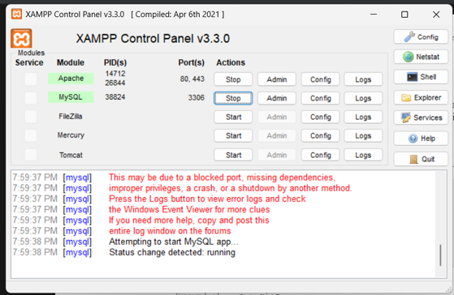

### 2. Mengakses phpMyAdmin

Setelah Apache dan MySQL berhasil dijalankan, membuka browser dan mengakses
alamat berikut:

http://localhost/phpmyadmin/

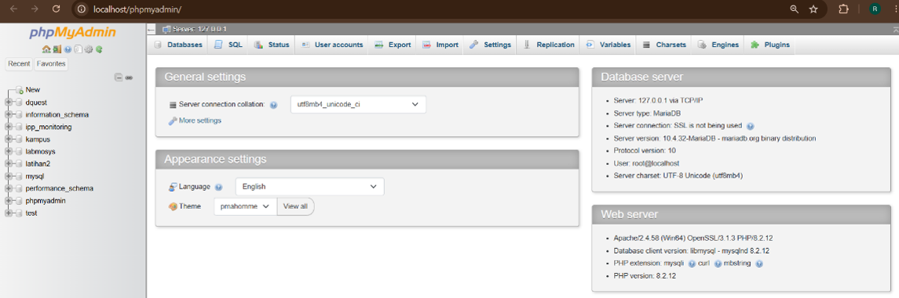

phpMyAdmin digunakan untuk mengelola database MySQL melalui browser.

### 3. Membuat Database

Selanjutnya membuat database baru dengan nama praktikum8 melalui phpMyAdmin.

Perintah SQL yang digunakan:

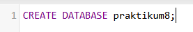

Database ini akan digunakan untuk menyimpan data barang

### 4. Membuat Tabel Data Barang

Setelah database berhasil dibuat, selanjutnya membuat tabel dengan nama data_barang.

Tabel tersebut memiliki beberapa kolom, yaitu:

- id_barang sebagai primary key dan auto increment.
- kategori untuk menyimpan kategori barang.
- nama untuk menyimpan nama barang.
- gambar untuk menyimpan nama file gambar.
- harga_beli untuk menyimpan harga beli barang.
- harga_jual untuk menyimpan harga jual barang.
- stok untuk menyimpan jumlah stok barang.

Perintah SQL:

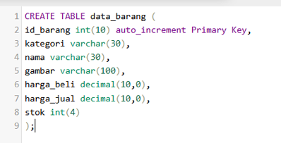

### 5. Menambahkan Data Barang

Setelah tabel berhasil dibuat, selanjutnya memasukkan beberapa data barang ke dalam
tabel data_barang.

Perintah SQL:

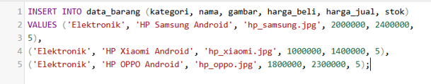

Hasilnya :

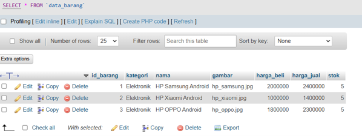

Beberapa data berhasil dimasukan ke dalam tabel data_barang.

### 6. Membuat Folder Project

Selanjutnya membuat folder project dengan nama lab8_php_database pada direktori
htdocs XAMPP.

C:\xampp\htdocs\lab8_php_database

Untuk mengakses project melalui browser menggunakan alamat:

http://localhost/lab8_php_database/

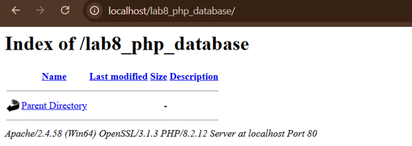

### 7. Membuat Koneksi Database

Membuat file baru dengan nama koneksi.php.
File ini digunakan untuk menghubungkan program PHP dengan database MySQL yang
telah dibuat sebelumnya.

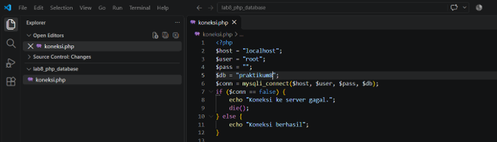

Setelah itu, membuka file koneksi.php melalui browser untuk menguji apakah koneksi
database berhasil dilakukan.

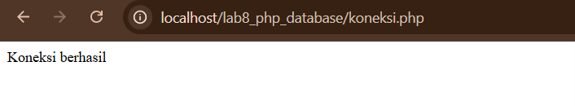

Jika success maka akan muncul pesan Koneksi berhasil jika gagal akan muncul pesan
Koneksi ke server gagal.

### 8. Menampilkan Data Barang (Read)

Selanjutnya membuat file index.php untuk menampilkan data barang yang tersimpan di
dalam database.
Data kemudian ditampilkan menggunakan tabel HTML dengan beberapa kolom, seperti
gambar, nama barang, kategori, harga beli, harga jual, dan stok.

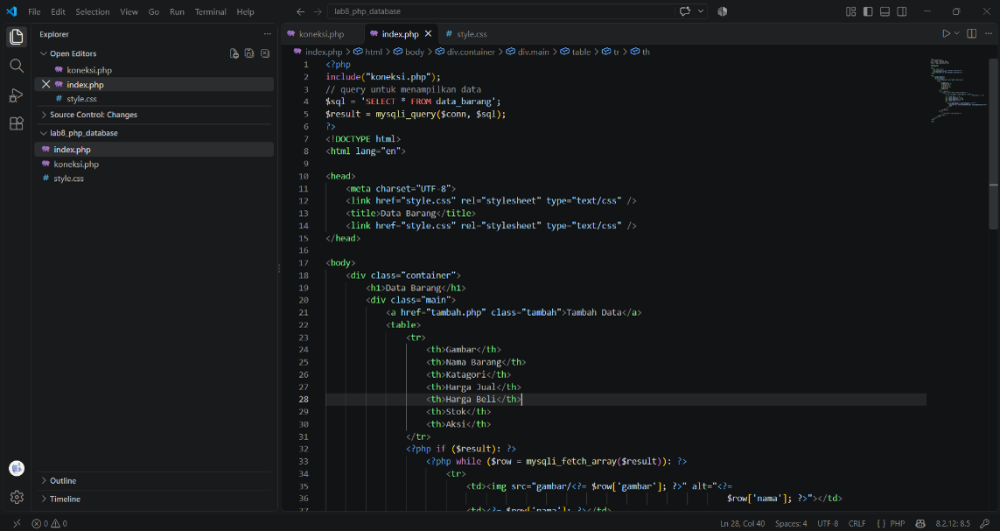

Hasilnya :

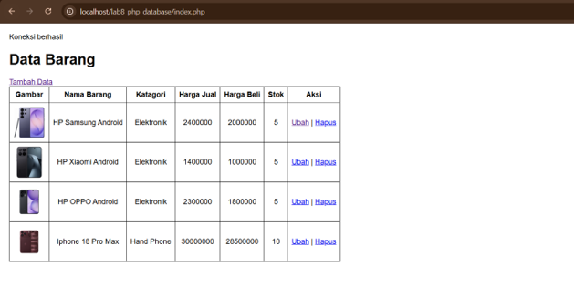

Muncul tabel dada barang dengan isi sesuai dengan data dari data_barang.

### 9. Menambahkan Data (Create)

Buat file baru bernama tambah.php
File ini digunakan untuk menambahkan data barang baru ke dalam database.

Pada proses ini menggunakan metode POST untuk mengirimkan data dari form. Selain
itu, menggunakan move_uploaded_file() untuk memindahkan file gambar yang diunggah
ke dalam folder gambar.

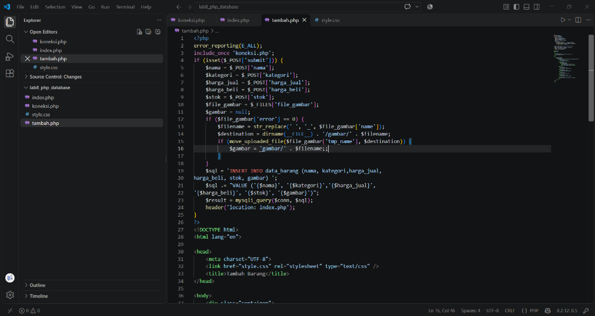

Hasilnya :

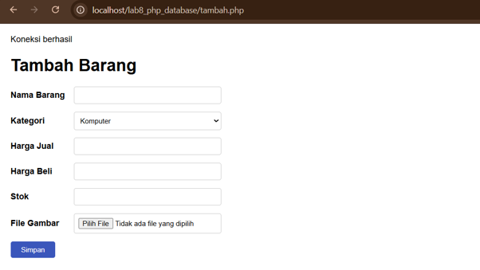

Sebuah form untuk menambahkan barang

### 10. Mengubah Data (Update)

Membuat file baru dengan nama ubah.php
File ini digunakan untuk mengubah data barang yang sudah tersimpan di dalam database.
Pertama, program mengambil ID barang melalui URL menggunakan metode GET.
Kemudian mengambil data barang berdasarkan ID tersebut dan menampilkannya kembali
ke dalam form. Setelah data diubah dan tombol Simpan ditekan, program menggunakan
perintah SQL UPDATE untuk memperbarui data barang.

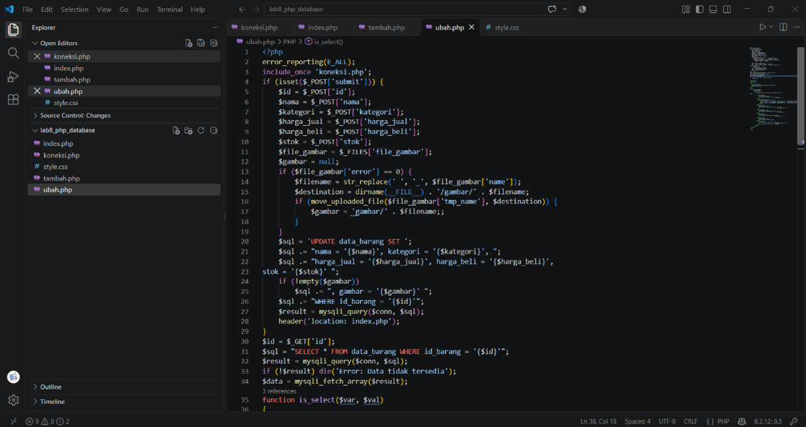

Hasilnya :

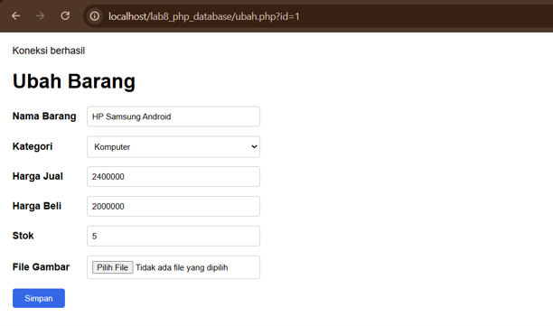

Sebuah Form untuk mengubah data barang yang telah dimasukan.

### 11. Menghapus Data (Delete)

Membuat file baru bernama hapus.php

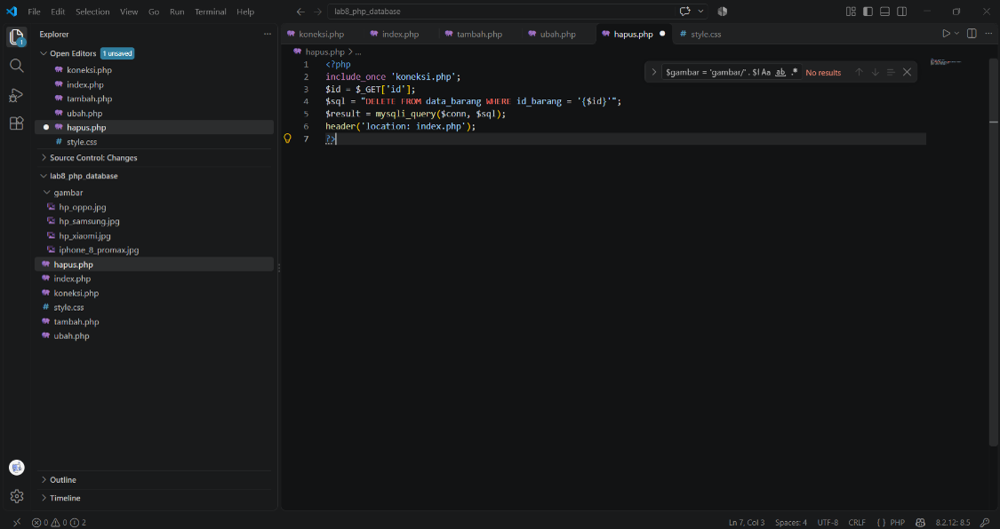

File ini digunakan untuk menghapus data barang berdasarkan ID barang yang dipilih.
Program mengambil ID barang melalui URL menggunakan metode GET. Kemudian
menjalankan perintah SQL DELETE untuk menghapus data dari tabel data_barang.
Setelah proses penghapusan selesai, halaman akan diarahkan kembali ke index.php.

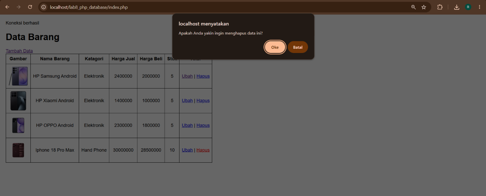
